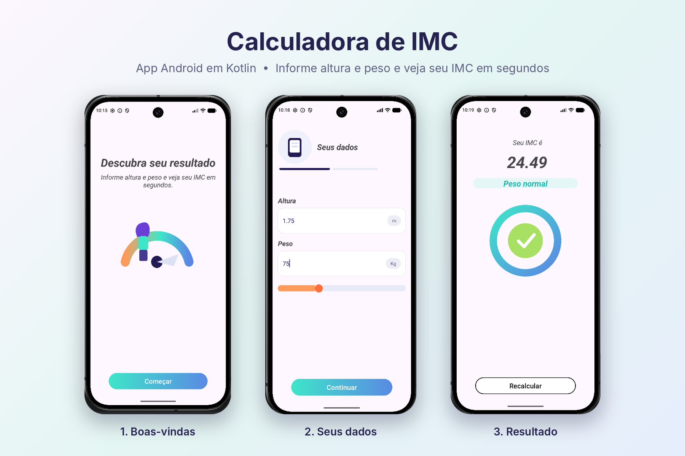

# 📱 Calculadora de IMC

Aplicativo Android para calcular o **Índice de Massa Corporal (IMC)**. O usuário informa altura e peso, o app valida os dados e mostra o resultado em uma segunda tela.

## 📸 Screenshots

<p align="center">
  
</p>

## ✨ Funcionalidades

- Entrada de altura e peso
- Validação dos campos (vazio, inválido ou menor/igual a zero)
- Cálculo do IMC: `peso / (altura * altura)`
- Envio do resultado para a próxima tela
- Exibição do IMC formatado com duas casas decimais

## 🛠️ Tecnologias utilizadas

**Linguagem e ferramentas**

- [Kotlin](https://kotlinlang.org/)
- [Android Studio](https://developer.android.com/studio)

**Conceitos de Android**

- Activity
- Intent
- Navegação entre Activities
- Passagem de dados entre telas
- Splash Screen

**Componentes de interface (XML)**

- ConstraintLayout
- TextInputLayout
- TextInputEditText
- ImageView
- TextView
- Button

**Lógica**

- Estruturas condicionais (`if` / `else`)

## 🚀 Como executar

1. Clone o repositório:
   ```bash
   git clone https://github.com/DiogoAlves345/App-IMC.git
   ```
2. Abra o projeto no **Android Studio**.
3. Aguarde o Gradle sincronizar.
4. Execute em um emulador ou em um dispositivo físico.

## 📂 Estrutura básica

```
app/
 └── src/main/
      ├── java/.../DadosActivity.kt       # Entrada e validação dos dados
      ├── java/.../ResultadoActivity.kt   # Exibição do resultado
      └── res/layout/                     # Layouts XML
```

## 👨‍💻 Autor

**Diogo Alves** — Mobile Developer

[LinkedIn](https://www.linkedin.com/in/diogo-alves-a680671b8) · [GitHub](https://github.com/DiogoAlves)
